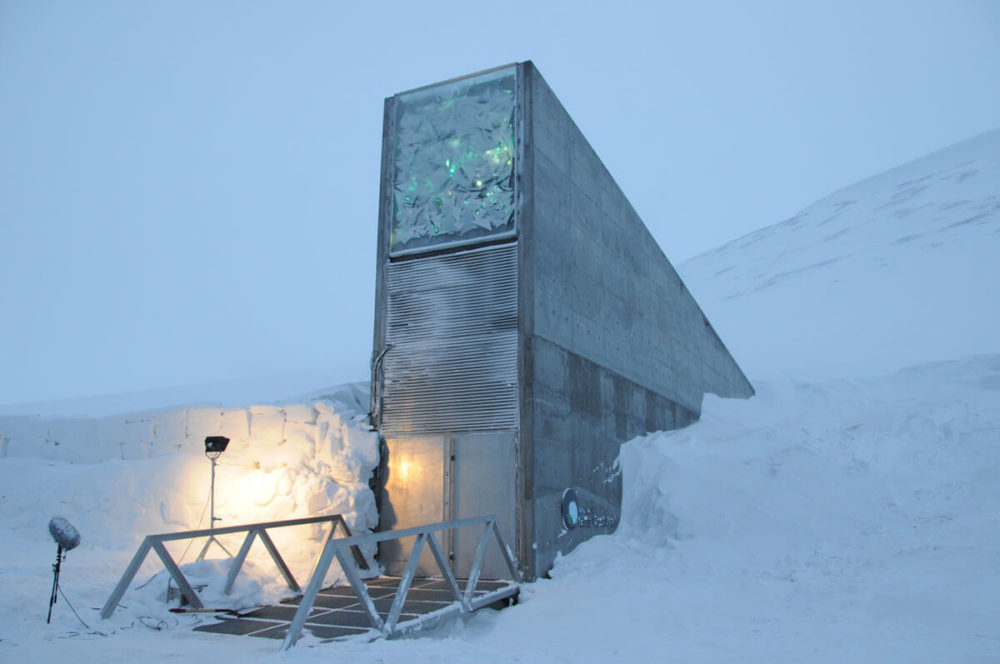
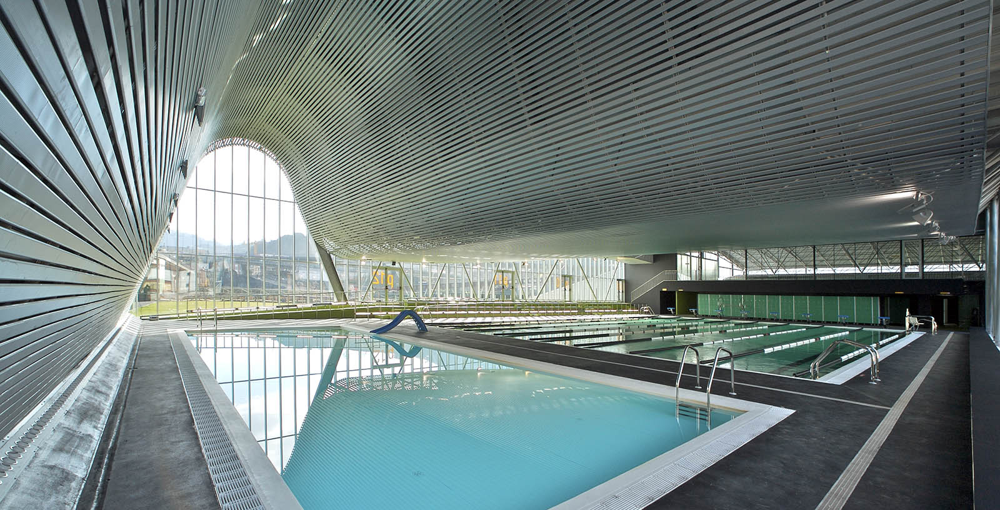
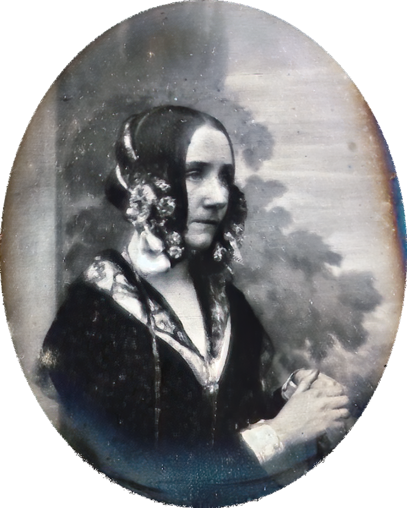

[← Volver al inicio](README.md)
# Temas del curso
### 1/10/2026-Premios princesa
 La Bóveda Global de Semillas de Svalbard cuyo objetivo es salvaguardar la diversidad de semillas de cultivos
 destinados a alimentación para garantizar el suministro futuro en caso de pérdida debida 
 a desastres naturales, conflictos humanos, cambios en las políticas, mala gestión o
 cualquier otra circunstancia. Su explicación por la que fue premiado se puede ver mejor en [la pagina oficial](https://www.fpa.es/es/premios-princesa-de-asturias/premiados/2026-boveda-global-de-semillas-svalbard/).
 Elegí este temas ya que me intereso su objetivo y me parece algo muy utíl y necesario.

esta imagen la saque buscando en [harolds lp](https://elheraldoslp.com.mx/new/wp-content/uploads/2022/02/Banco-Global-de-Semillas-de-Svalbard.jpg)
### 18/09 — Natación

Pues ahora no hago nada pero voy a empezar el gimnasio pero antes hacia 
natación la cual practique en diciembre hasta marzo ya que me iba a meter al gimnasio
pero no he ido casi, natación me gusto mucho pero no era algo que me agradaba,
iba los lunes, miércoles y viernes.

[curso de natación](https://github.com/gmadridsports/app-natacion)
### 16/10/2026 - Ada Lovelace
[Ada Lovelace](https://es.wikipedia.org/wiki/Ada_Lovelace)fue una matemática y escritora británica, se celebra su día por su duro trabajo sobre la computadora mecánica de uso general y fue dominada como maquina analítica. Fue la primera en asumir que la computadora tenia mas aplicaciones más allá del calculo puro y en haberlo publicado se reconoce hoy como el primer algoritmo destinado a ser procesado por una maquina.su celebración se hace cada año el segundo martes de octubre para reconocer el aporte de Ada Lovelace a la ciencia, la tecnología, la ingeniería y las matemáticas y para visibilizar el papel de las mujeres en estos campos.
{: width="300"}
